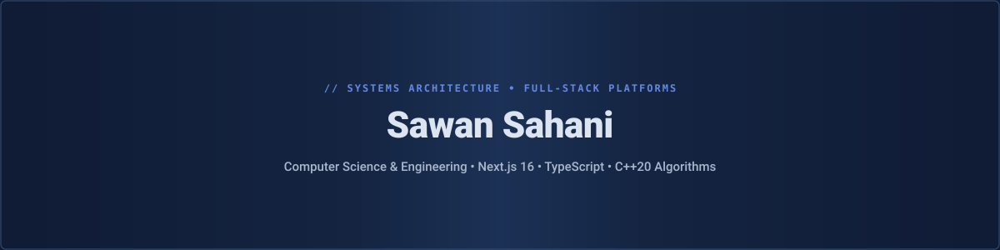

  <!-- A. Hero Banner -->
  

  <!-- Animated Typing Subtitle -->
  

<!-- B. About Me -->

  <h3>⚡ About Me</h3>

  

    Hello! I'm <b>Sawan Sahani</b>, a Computer Science & Engineering student passionate about crafting clean, efficient full-stack web applications and mastering algorithmic problem-solving.
  

  <table align="center" width="100%">
    <tr>
      <td width="50%" valign="top">
        <b>🔭 Currently Building:</b> 
        Scalable full-stack platforms with modular architectures, cloud persistence, and reactive UIs.
      </td>
      <td width="50%" valign="top">
        <b>🌱 Currently Learning:</b> 
        Advanced full-stack patterns with Next.js App Router, TypeScript, and Supabase cloud services.
      </td>
    </tr>
    <tr>
      <td width="50%" valign="top">
        <b>💡 Technical Focus:</b> 
        Modern web ecosystem, component engineering, RESTful APIs, and algorithmic complexity optimization.
      </td>
      <td width="50%" valign="top">
        <b>🎯 Problem Solving:</b> 
        Active competitive programmer and DSA practitioner solving challenges on LeetCode &amp; Codeforces in C++.
      </td>
    </tr>
  </table>

<!-- C. Technology Stack -->

  <h3>🛠️ Technology Stack</h3>

  <table align="center" width="100%">
    <tr>
      <td width="50%" valign="top">
        <h4>💻 Languages</h4>
        

          
        

        
C++ • JavaScript • TypeScript • HTML5 • CSS3

      </td>
      <td width="50%" valign="top">
        <h4>🎨 Frontend Ecosystem</h4>
        

          
        

        
React.js • Next.js • Tailwind CSS

      </td>
    </tr>
    <tr>
      <td width="50%" valign="top">
        <h4>⚙️ Backend &amp; Cloud</h4>
        

          
        

        
Supabase • PostgreSQL • RESTful APIs

      </td>
      <td width="50%" valign="top">
        <h4>🛠️ Developer Tooling</h4>
        

          
        

        
Git • GitHub • VS Code

      </td>
    </tr>
  </table>

<!-- D. Featured Projects -->

  <h3>📂 Featured Projects</h3>

  <table align="center" width="100%">
    <tr>
      <td width="50%" valign="top">
        <h4><a href="https://github.com/Sawan017/CodeAscend">🚀 CodeAscend</a></h4>
        
Developer career progression platform featuring real-time tracking, modular architectures, and cloud persistence.

        
<b>Stack:</b> TypeScript • React • Supabase • Tailwind CSS

        
<a href="https://github.com/Sawan017/CodeAscend"><b>View Repository &rarr;</b></a>

      </td>
      <td width="50%" valign="top">
        <h4><a href="https://github.com/Sawan017/leetcode-solutions">💡 LeetCode Solutions</a></h4>
        
Structured repository of algorithmic problem solutions in C++ covering data structures, dynamic programming, and optimization.

        
<b>Stack:</b> C++ • Data Structures • Algorithms • Optimization

        
<a href="https://github.com/Sawan017/leetcode-solutions"><b>View Repository &rarr;</b></a>

      </td>
    </tr>
    <tr>
      <td width="50%" valign="top">
        <h4><a href="https://github.com/Sawan017/codeforces-solutions">⚔️ Codeforces Solutions</a></h4>
        
Competitive programming solutions and contest practices focused on mathematical modeling and runtime efficiency.

        
<b>Stack:</b> C++ • Competitive Programming • Mathematics

        
<a href="https://github.com/Sawan017/codeforces-solutions"><b>View Repository &rarr;</b></a>

      </td>
      <td width="50%" valign="top">
        <h4><a href="https://github.com/Sawan017/sawan-demo">🌱 Sawan Demo</a></h4>
        
Foundational Git repository demonstrating version control workflows and initial web development practices.

        
<b>Stack:</b> HTML5 • CSS3 • Git Version Control

        
<a href="https://github.com/Sawan017/sawan-demo"><b>View Repository &rarr;</b></a>

      </td>
    </tr>
  </table>

<!-- E. GitHub Statistics Dashboard -->

  <h3>📈 GitHub Statistics &amp; Activity</h3>

  

    
    
  

  

    
  

<!-- F. Contribution Snake -->

  <h3>🐍 Contribution Snake</h3>

  <picture>
    <source media="(prefers-color-scheme: dark)" srcset="https://raw.githubusercontent.com/Sawan017/Sawan017/output/github-contribution-grid-snake-dark.svg" />
    <source media="(prefers-color-scheme: light)" srcset="https://raw.githubusercontent.com/Sawan017/Sawan017/output/github-contribution-grid-snake.svg" />
    
  </picture>

<!-- G. 3D Contribution Graph -->

  <h3>🌐 3D Contribution Graph</h3>

  

<!-- H. Developer Contact & Minimal Footer -->

  <h3>📫 Connect With Me</h3>

  

    
  

   

  

