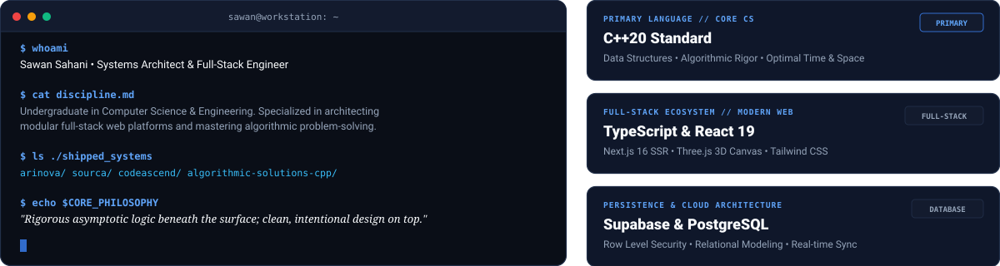
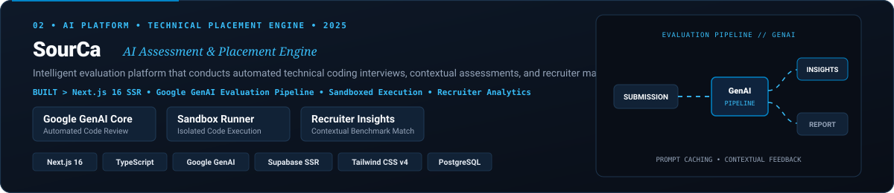
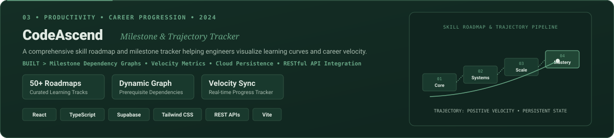
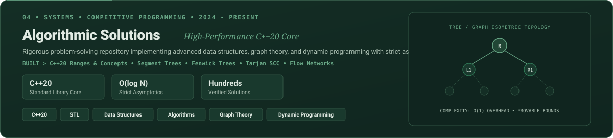

  <!-- ========================================== -->
  <!-- 1. ANIMATED HERO & IDENTITY                -->
  <!-- ========================================== -->

  

    
  

  <!-- Quick Action Buttons -->
  

    
    &nbsp;
    
    &nbsp;
    
    &nbsp;
    
  

  

    
  

<!-- ========================================== -->
<!-- 2. ABOUT ME                                -->
<!-- ========================================== -->

## 👨‍💻 About Me

  

  Hello! I am <b>Sawan Sahani</b> (<a href="https://github.com/Sawan017">@Sawan017</a>), a Computer Science &amp; Engineering undergraduate focused on architecting resilient full-stack web platforms, interactive 3D web environments, and mastering asymptotic algorithmic problem-solving in <b>C++20</b>.

  

<!-- ========================================== -->
<!-- 3. FEATURED PROJECTS                       -->
<!-- ========================================== -->

## 🚀 Featured Projects

  Flagship software systems, architectural prototypes, and algorithmic solutions with verified repositories.

<!-- Project 1: ARINOVA -->

  

  
  &nbsp;&nbsp;
  

 

<!-- Project 2: SourCa -->

  

  
  &nbsp;&nbsp;
  

 

<!-- Project 3: CodeAscend -->

  

  

 

<!-- Project 4: Algorithmic Solutions -->

  

  

  

<!-- ========================================== -->
<!-- 4. TECHNOLOGY STACK                        -->
<!-- ========================================== -->

## 🛠️ Technology Stack

  

  

<!-- ========================================== -->
<!-- 5. AUTHENTIC GITHUB ACTIVITY               -->
<!-- ========================================== -->

## 📊 Authentic GitHub Activity

  <!-- Exactly ONE Authentic Contribution Graph: Animated GitHub Snake eating real contributions -->
  

  

<!-- ========================================== -->
<!-- 6. GITHUB STATISTICS                       -->
<!-- ========================================== -->

## 📈 GitHub Statistics

  
  &nbsp;&nbsp;
  

  

<!-- ========================================== -->
<!-- 7. GET IN TOUCH                            -->
<!-- ========================================== -->

## 📬 Get in Touch

  

  
  &nbsp;
  
  &nbsp;
  
  &nbsp;
  

  © 2026 Sawan Sahani • Handcrafted Royal Dark Systems Architecture

