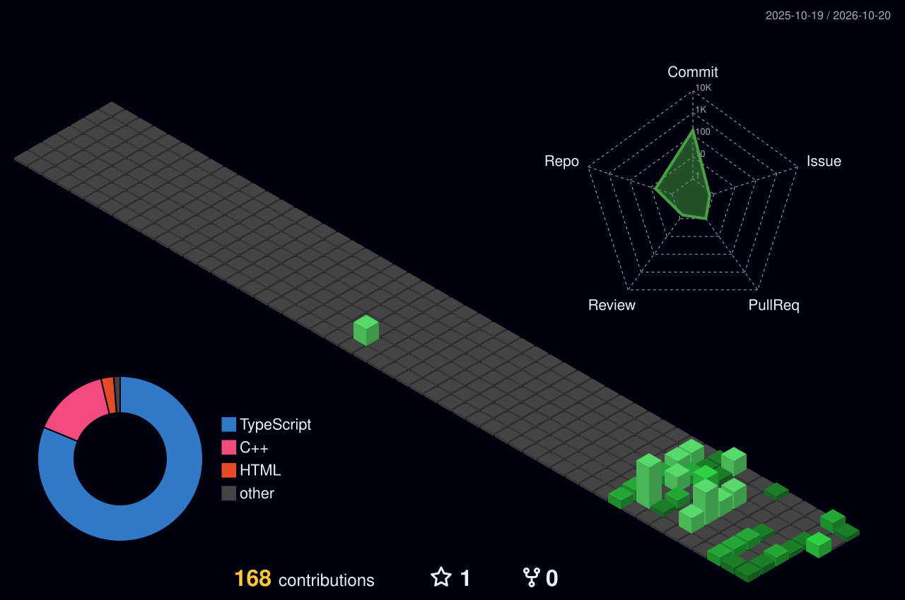

  <!-- 1. Animated Burgundy/Rose Hero Header -->
  

  <!-- 2. Typing Animation -->
  

<!-- 3. About Me Section -->

  <h3>✨ About Me</h3>

  

    Hello! I am <b>Sawan Sahani</b>, a Computer Science & Engineering student passionate about crafting clean, robust full-stack web applications and solving complex algorithmic challenges. 
    Currently focused on modern component systems, scalable cloud databases, and high-performance user experiences.
  

  

    🌱 &nbsp;<b>Learning:</b> Full-Stack Web Development (Next.js, TypeScript & Supabase) 
    🎯 &nbsp;<b>Focus:</b> Clean Architecture, Responsive UI Design & Modern Web Ecosystems 
    💡 &nbsp;<b>Problem Solving:</b> Data Structures & Algorithms Practice in C++ 
    📫 &nbsp;<b>Connect:</b> <a href="https://github.com/Sawan017">@Sawan017 on GitHub</a>
  

<!-- 4. Technologies & Tools Icon Grid -->

  <h3>🛠️ Technologies & Tools</h3>

  

    
  

<!-- 5. Featured Projects -->

  <h3>📂 Featured Projects</h3>

  <table align="center" width="100%">
    <tr>
      <td width="50%" valign="top">
        <h4>🚀 <a href="https://github.com/Sawan017/CodeAscend">CodeAscend</a></h4>
        
A personal developer growth and learning progress platform featuring interactive progression tracking, modern component architectures, and cloud persistence.

        
<b>Tech:</b> <code>TypeScript</code> <code>React</code> <code>Supabase</code>

      </td>
      <td width="50%" valign="top">
        <h4>💡 <a href="https://github.com/Sawan017/leetcode-solutions">LeetCode Solutions</a></h4>
        
A structured repository of algorithmic problem solutions in C++, covering data structures, dynamic programming, graphs, and optimization.

        
<b>Tech:</b> <code>C++</code> <code>Algorithms</code> <code>DSA</code>

      </td>
    </tr>
    <tr>
      <td width="50%" valign="top">
        <h4>⚔️ <a href="https://github.com/Sawan017/codeforces-solutions">Codeforces Solutions</a></h4>
        
Competitive programming solutions and contest practices focused on mathematical thinking, algorithmic efficiency, and problem solving.

        
<b>Tech:</b> <code>C++</code> <code>Competitive Programming</code>

      </td>
      <td width="50%" valign="top">
        <h4>🌱 <a href="https://github.com/Sawan017/sawan-demo">Sawan Demo</a></h4>
        
Foundational Git repository demonstrating version control workflows, web structure experiments, and early coding prototypes.

        
<b>Tech:</b> <code>HTML</code> <code>CSS</code> <code>Git</code>

      </td>
    </tr>
  </table>

<!-- 6. GitHub Statistics and Contribution Activity -->

  <h3>📈 GitHub Statistics & Activity</h3>

  

    
    
  

  

    
  

<!-- 7. Animated Contribution Snake -->

  <h3>🐍 Contribution Snake</h3>

  <picture>
    <source media="(prefers-color-scheme: dark)" srcset="https://raw.githubusercontent.com/Sawan017/Sawan017/output/github-contribution-grid-snake-dark.svg" />
    <source media="(prefers-color-scheme: light)" srcset="https://raw.githubusercontent.com/Sawan017/Sawan017/output/github-contribution-grid-snake.svg" />
    
  </picture>

<!-- 8. Existing 3D Contribution Graph -->

  <h3>🌐 3D Contribution Graph</h3>

  

<!-- 9. Minimal Matching Footer -->

  

    Crafted with code & curiosity • <a href="https://github.com/Sawan017">@Sawan017</a>
  

  

