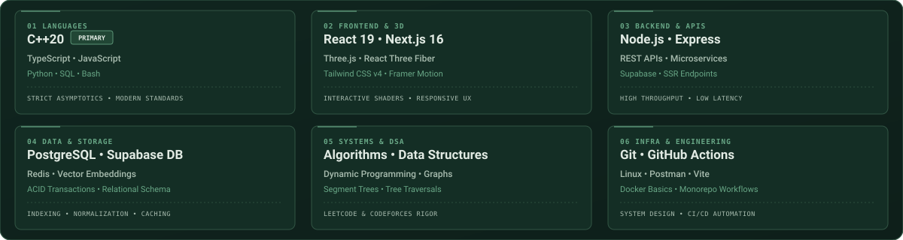
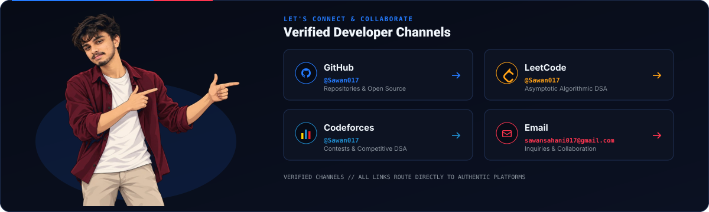
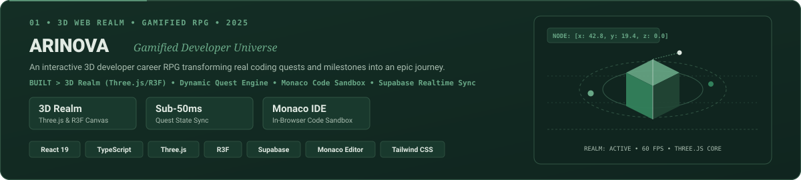

  <!-- ========================================== -->
  <!-- 1. ANIMATED HERO & IDENTITY                -->
  <!-- ========================================== -->

  

    

  <!-- Animated Typing Subtitle -->
  

    

  

<!-- ========================================== -->
<!-- 2. ABOUT ME                                -->
<!-- ========================================== -->

## ⚡ About Me

  

 

  Hello! I'm <b>Sawan Sahani</b>, a Computer Science &amp; Engineering undergraduate focused on architecting resilient full-stack web platforms, interactive 3D ecosystems, and mastering asymptotic algorithmic problem-solving.

<table align="center" width="100%">
  <tr>
    <td width="50%" valign="top">
      <h4>🔭 Current Engineering Focus</h4>
      

        Building modular full-stack web platforms with reactive state trees, strict TypeScript typing contracts, and scalable cloud persistence using <b>Next.js App Router</b>, <b>TypeScript</b>, and <b>Supabase</b>.
      

    </td>
    <td width="50%" valign="top">
      <h4>🌱 Active Technical Exploration</h4>
      

        Exploring interactive 3D web environments via <b>Three.js</b> and <b>React Three Fiber</b>, distributed cloud database architectures, and type-level metaprogramming.
      

    </td>
  </tr>
  <tr>
    <td width="50%" valign="top">
      <h4>⚔️ Algorithmic Rigor</h4>
      

        Dedicated competitive programmer and computer science practitioner solving challenges on <b>LeetCode</b> and <b>Codeforces</b> in <b>C++20</b> with optimal runtime and space complexity.
      

    </td>
    <td width="50%" valign="top">
      <h4>💡 Systems Philosophy</h4>
      

        Prioritizing clean separation of concerns, defensive database security with Row Level Security (RLS), comprehensive static analysis, and understated, intentional user experiences.
      

    </td>
  </tr>
</table>

 

  

<!-- ========================================== -->
<!-- 3. HANGING DEVELOPER ID                    -->
<!-- ========================================== -->

## 🪪 Verified Developer Credential

  

  

    <b>Credential Verification:</b> Active Contributor &bull; GitHub Identity <a href="https://github.com/Sawan017">@Sawan017</a> &bull; CSE Department
  

   

  

<!-- ========================================== -->
<!-- 4. TECHNOLOGY STACK                        -->
<!-- ========================================== -->

## 🛠️ Technology Stack &amp; Systems

  A structured taxonomy of languages, frameworks, and developer tooling actively utilized across my systems:

  <!-- Animated Three-Orbit Technology Graphic -->
  

    

  <!-- Recognizable Brand Logos -->
  

    
  

   

  

<!-- ========================================== -->
<!-- 5. FEATURED PROJECTS                       -->
<!-- ========================================== -->

## 📂 Featured Projects

  Flagship applications, AI evaluation platforms, and algorithmic repositories:

  <!-- Featured Projects Visual Presentation -->
  

 

<table align="center" width="100%">
  <tr>
    <!-- Project 1: ARINOVA -->
    <td width="50%" valign="top" align="center">
      
       
      

        <b>👑 ARINOVA — Gamified Developer Career RPG</b> 
        A futuristic developer career RPG turning real-world learning, coding quests, and milestones into an interactive adventure. Integrates a 3D realm built with Three.js/R3F, Monaco code editor, dynamic skill trees, and real-time social networking.
      

      

        <b>Stack:</b> React 19 • TypeScript • Three.js / R3F • Supabase • Monaco Editor • Framer Motion 
        <a href="https://github.com/Sawan017/CodeAscend"><b>Explore Project Repository &rarr;</b></a>
      

    </td>
    <!-- Project 2: SourCa -->
    <td width="50%" valign="top" align="center">
      
       
      

        <b>🧠 SourCa — AI Placement &amp; Assessment Engine</b> 
        An intelligent campus recruitment &amp; technical assessment platform delivering dynamic coding puzzles, automated test-suite verification, recruiter benchmarking, and Google GenAI-powered code evaluations.
      

      

        <b>Stack:</b> Next.js 16 • TypeScript • Google GenAI • Supabase SSR • Monaco • Tailwind CSS v4 
        <a href="https://github.com/Sawan017/SourCa"><b>Explore Project Repository &rarr;</b></a>
      

    </td>
  </tr>
  <tr>
    <!-- Project 3: CodeAscend -->
    <td width="50%" valign="top" align="center">
      
       
      

        <b>🚀 CodeAscend — Skill &amp; Progression Tracker</b> 
        A developer progression and skill trajectory platform providing structured milestone roadmaps, modular component architectures, cloud-synced state, and interactive learning analytics.
      

      

        <b>Stack:</b> TypeScript • React • Supabase • Tailwind CSS • RESTful APIs 
        <a href="https://github.com/Sawan017/CodeAscend"><b>Explore Project Repository &rarr;</b></a>
      

    </td>
    <!-- Project 4: LeetCode & Codeforces DSA -->
    <td width="50%" valign="top" align="center">
      
       
      

        <b>⚔️ Algorithmic Solutions &amp; Competitive Programming</b> 
        Structured, tested solutions in modern C++ spanning dynamic programming, graph theory, trees, binary search, and mathematical modeling with strict focus on runtime and memory optimization.
      

      

        <b>Stack:</b> C++20 • Data Structures • Algorithms • Optimization • LeetCode • Codeforces 
        <a href="https://github.com/Sawan017/leetcode-solutions"><b>LeetCode Solutions &rarr;</b></a> &bull; <a href="https://github.com/Sawan017/codeforces-solutions"><b>Codeforces Solutions &rarr;</b></a>
      

    </td>
  </tr>
</table>

 

  

<!-- ========================================== -->
<!-- 6. DEVELOPER JOURNEY                       -->
<!-- ========================================== -->

## 🧭 Developer Journey &amp; Horizons

  My progression path bridging undergraduate computer science fundamentals with production software engineering:

<table align="center" width="100%">
  <tr>
    <td width="25%" valign="top">
      <b>🏛️ 1. Academic Core</b> 
      Rigorous foundational studies in Operating Systems, Database Management Systems, Computer Networks, and Discrete Mathematics.
    </td>
    <td width="25%" valign="top">
      <b>⚔️ 2. Algorithmic Rigor</b> 
      Continuous problem-solving and contest participation in C++20 on LeetCode and Codeforces, focusing on asymptotic complexity.
    </td>
    <td width="25%" valign="top">
      <b>🚀 3. Flagship Platforms</b> 
      Engineering full-stack architectures (ARINOVA &amp; SourCa) with Next.js 16, React 19, Three.js, and Supabase cloud persistence.
    </td>
    <td width="25%" valign="top">
      <b>🌟 4. Long-Term Horizon</b> 
      Designing scalable distributed architectures, developer tooling, and high-performance interactive interfaces.
    </td>
  </tr>
</table>

 

  

<!-- ========================================== -->
<!-- 7. GITHUB STATISTICS & ACTIVITY            -->
<!-- ========================================== -->

## 📈 GitHub Statistics &amp; Activity

  <!-- Graphite & Antique Gold Themed Stats Cards -->
  

    
    
  

  

    
  

   

  <!-- Contribution Snake -->
  <h4>🐍 Contribution Velocity</h4>

  <picture>
    <source media="(prefers-color-scheme: dark)" srcset="https://raw.githubusercontent.com/Sawan017/Sawan017/output/github-contribution-grid-snake-dark.svg" />
    <source media="(prefers-color-scheme: light)" srcset="https://raw.githubusercontent.com/Sawan017/Sawan017/output/github-contribution-grid-snake.svg" />
    
  </picture>

    

  <!-- 3D Contribution Graph in Forest Green -->
  <h4>🌐 Isometric Contribution Landscape</h4>

  

    

  

<!-- ========================================== -->
<!-- 8. CONTACT & COLLABORATION                 -->
<!-- ========================================== -->

## 📫 Connect &amp; Collaborate

  

    I am always open to discussing full-stack engineering opportunities, scalable system architectures, interactive applications, and algorithmic challenges.
  

  

    
    &nbsp;
    
    &nbsp;
    
    &nbsp;
    
  

    

  

