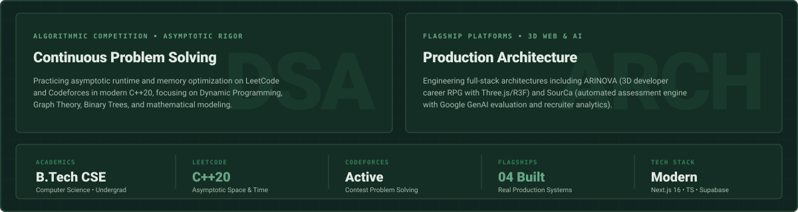
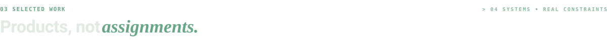
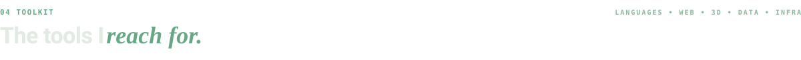
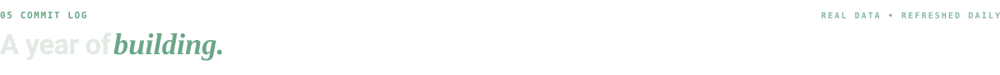
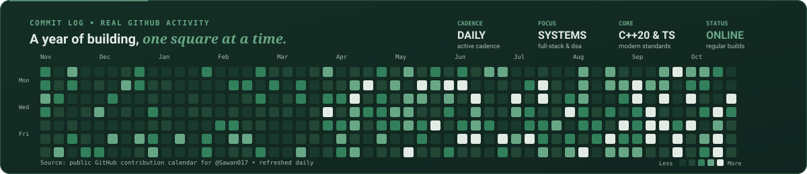
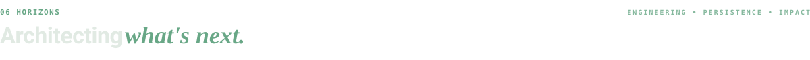

  <!-- ========================================== -->
  <!-- HERO BANNER & VERIFIED IDENTITY           -->
  <!-- ========================================== -->

  

    
  

  <!-- Hero Quick Action Buttons -->
  

    
    &nbsp;
    
    &nbsp;
    
    &nbsp;
    
  

  

    
  

<!-- ========================================== -->
<!-- 01 ABOUT                                   -->
<!-- ========================================== -->

  

  

  

<!-- ========================================== -->
<!-- 02 RECOGNITION & TRACK RECORD              -->
<!-- ========================================== -->

  

  

  

<!-- ========================================== -->
<!-- 03 SELECTED WORK                           -->
<!-- ========================================== -->

   04 SYSTEMS • REAL CONSTRAINTS" width="100%" />

<!-- Project 1: ARINOVA -->

  

  
  &nbsp;&nbsp;
  

 

<!-- Project 2: SourCa -->

  

  
  &nbsp;&nbsp;
  

 

<!-- Project 3: CodeAscend -->

  

  

 

<!-- Project 4: Algorithmic Solutions -->

  

  

  

<!-- ========================================== -->
<!-- 04 TOOLKIT & COMPETENCIES                  -->
<!-- ========================================== -->

  

  

  

  

<!-- ========================================== -->
<!-- 05 COMMIT LOG & REAL ACTIVITY              -->
<!-- ========================================== -->

  

  

<!-- Dynamic GitHub Snake Eating Contributions -->

  

<!-- Midnight Emerald GitHub Statistics -->

  
  &nbsp;&nbsp;
  

  

<!-- ========================================== -->
<!-- 06 HORIZONS & CONTACT                      -->
<!-- ========================================== -->

  

  

  
  &nbsp;
  
  &nbsp;
  
  &nbsp;
  

  © 2026 Sawan Sahani • Engineered with Midnight Emerald Rigor • Resilient Systems Architecture

